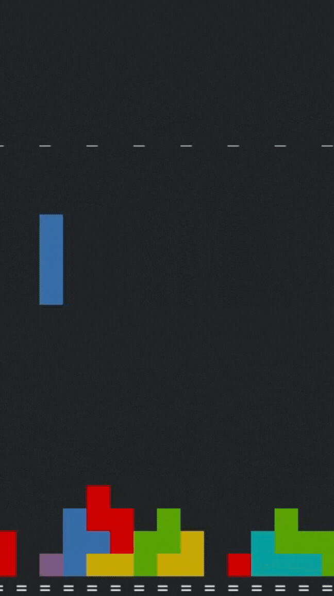
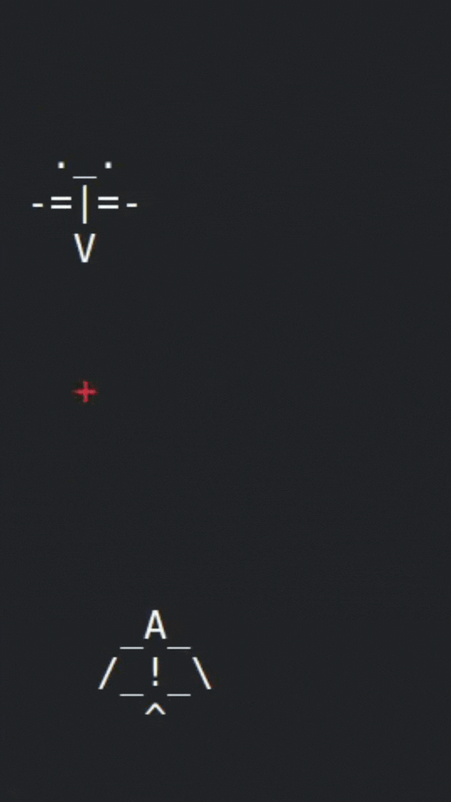
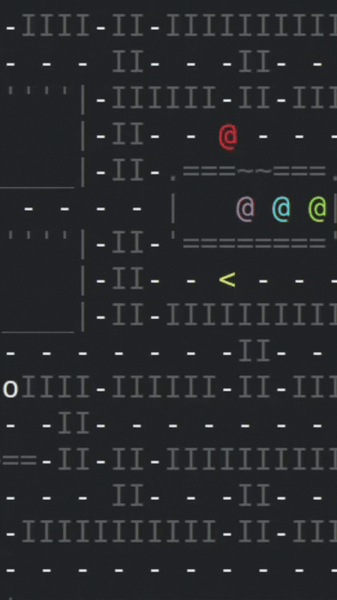

```c
#define HIGH 4
#define LENGTH 75
char hello_world[HIGH][LENGTH] = {
  " _   _   ___   _     _     ___     _  _  _   ___   ____   _     ___     _ ",
  "| |_| | | __| | |   | |   | . |   | || || | | . | |  | | | |   |  . |  | |",
  "|  _  | | _|  | |_  | |_  | | |   |  ' '  | | | | |  --' | |_  |  | |  |_|",
  "|_| |_| |___| |___| |___| '___'    \_/ \_/  '___' |_|\_\ |___| |___.'   O ",
}
```
<code>
<h1 align="center">👾 Welcome! o/ 👾</h1>
<h3 align="center">Here I post cool stuff I make :D</h3>
<div align="center">
I'm a second-semester Computer Science student. I'm primarily familiar with C, C++, and Python.  
I started my programming journey with C, and my current focus is on object-oriented programming and programming logic.  
  
I have a particular interest in computational thinking, algorithm design, and the mathematical logic behind problem-solving. I enjoy investigating how machines can approach problems, developing algorithms to model decision-making, search strategies, optimization, and other computational processes.  

What fascinates me most is the process of understanding a problem, breaking it down into logical steps, and figuring out how a machine can solve it.
My projects focus on applying theoretical concepts from computer science and mathematics, as well as exploring program architecture and structure. I've developed several terminal-based games, along with some interesting algorithms that I've also shared on my profile. I'm always looking to build projects with increasing levels of logical complexity and scale, challenging myself to make each one a step beyond the last.  

Outside of software development, I spend my time with drawings and sewings and guitars and grunge music...  
I also have an appreciation for linguistics, theology, and literature, which I explore purely out of personal interest.   
</div>
</code>
&nbsp;  
&nbsp;  

<p align="center">
  &nbsp;&nbsp;&nbsp;&nbsp;&nbsp;&nbsp;&nbsp;&nbsp;&nbsp;&nbsp;&nbsp;&nbsp;
  &nbsp;&nbsp;&nbsp;&nbsp;&nbsp;&nbsp;&nbsp;&nbsp;&nbsp;&nbsp;&nbsp;&nbsp;
  
</p>
<code>In order: TETRIS, ACE-COMBAT, PACMAN, all avaiable in my repositories.</code>  
&nbsp;  
&nbsp;  
&nbsp;  
&nbsp;  
<h1 align="center">GitHub Stats</h1>
<p align="center">
  
  &nbsp;&nbsp;&nbsp;&nbsp;&nbsp;&nbsp;&nbsp;&nbsp;&nbsp;&nbsp;&nbsp;&nbsp;
  
</p>

<div align="center">
  
</div>